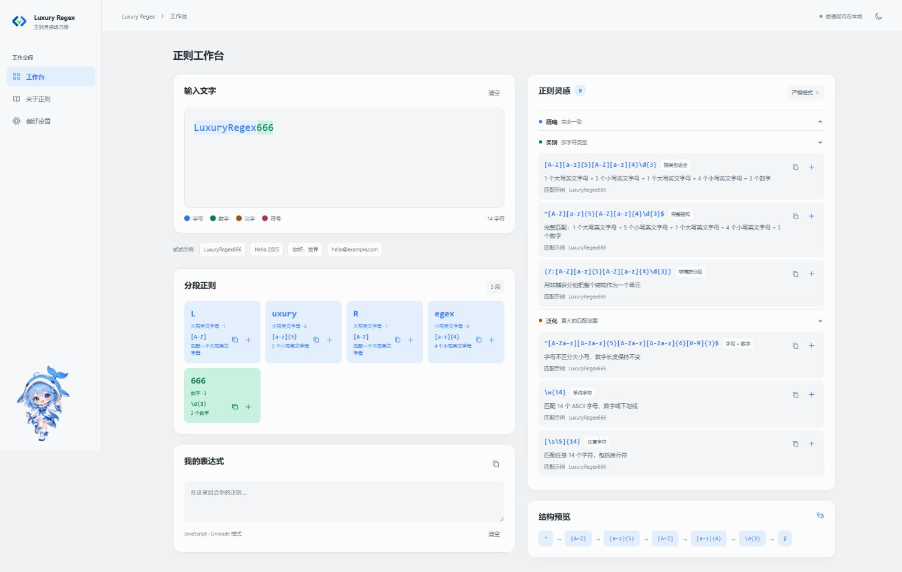
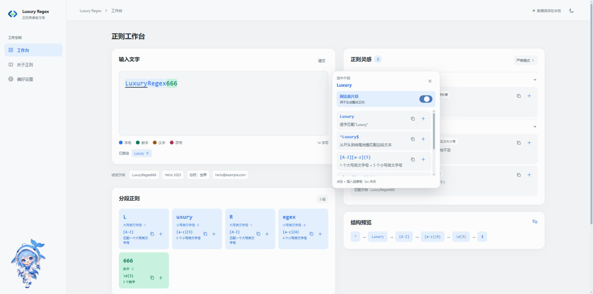
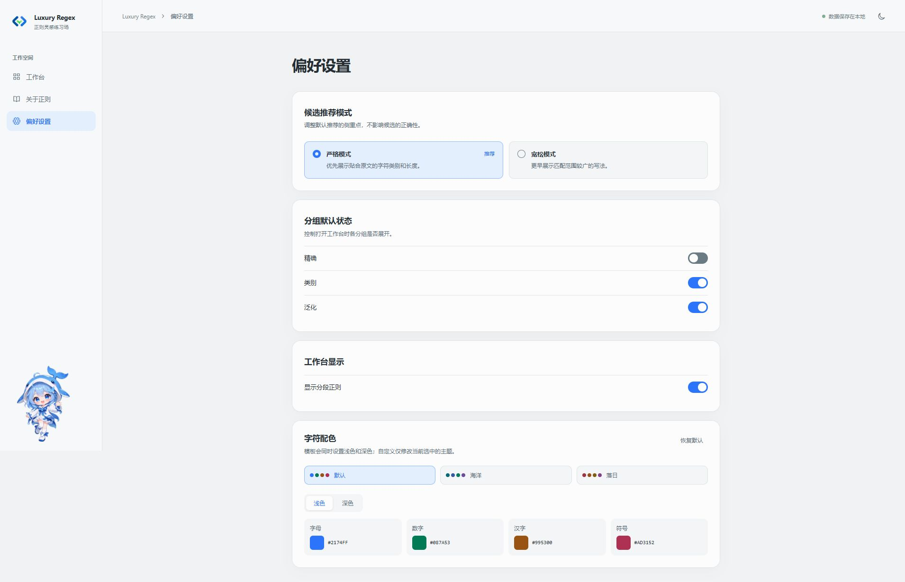

# Luxury Regex

**从一段文字出发，理解正则的不同写法。**

Luxury Regex 是一个本地运行的正则学习工具。输入示例文本，即可对比精确匹配、字符类别和更宽泛的候选表达式，查看解释与匹配示例，也可以固定部分内容，再推导剩余结构。

适合学习正则、寻找表达式灵感，以及比较不同规则的匹配范围。候选由本地规则生成，不需要 AI 服务或 API Key。

## 界面预览

### 工作台

按字符类别高亮输入，同时展示分段建议、整体候选和结构预览。



### 选区分析与固定片段

选中文字即可查看局部建议。开启「固定此片段」后，整体候选保留该片段的原文，其他部分按字符类型推导。



### 偏好设置

调整推荐模式、分组默认展开状态、分段显示，以及浅色和深色主题下的字符配色。



## 功能

| 功能 | 说明 |
| --- | --- |
| 字符分类 | 区分英文字母、Unicode 字母、ASCII / Unicode 数字、汉字、空白和符号 |
| 候选解释 | 展示表达式、用途说明和可匹配的示例 |
| 严格 / 宽松模式 | 严格模式优先展示字符类别；宽松模式提前展示泛化分组 |
| 分段与选区分析 | 查看连续同类字符的建议，或选中任意片段单独分析 |
| 固定片段 | 支持固定多个片段，对比保持长度、字母不区分大小写和长度可变的整体候选 |
| 表达式组合 | 复制候选，或点击 `+` 追加到「我的表达式」中继续编辑 |
| 外观设置 | 支持深浅主题、配色模板和各字符类别的自定义颜色 |
| 基础知识 | 内置字符类、量词、分组、断言和 JavaScript 标志的说明 |

## 快速开始

需要 **Node.js 22.12 或更高版本**，使用 npm 安装依赖。

```bash
git clone https://github.com/why-qw1ko/LuxuryRegex.git
cd LuxuryRegex
npm install
npm run dev
```

启动后访问 [http://127.0.0.1:5173](http://127.0.0.1:5173)。

- 启动脚本已包含 Node 22 所需的 `--experimental-sqlite` 标志；出现 SQLite 实验性提示不代表启动失败。
- 默认仅监听本机地址 `127.0.0.1`。
- 修改 `server.mjs` 或服务端设置模块后，需要停止并重新运行 `npm run dev`。

如果端口被占用，可以通过 `PORT` 修改 HTTP 端口，通过 `HMR_PORT` 修改热更新端口。例如在 PowerShell 中：

```powershell
$env:PORT = "5174"
$env:HMR_PORT = "24679"
npm run dev
```

此时访问 `http://127.0.0.1:5174`。

## 使用示例

1. 在工作台输入 `LuxuryRegex666`，查看分段和整体候选。
2. 选中 `Luxury`，打开「固定此片段」。
3. 比较以下候选的差异：

   ```regex
   ^Luxury[A-Z][a-z]{4}\d{3}$
   ^Luxury[A-Za-z]{5}\d{3}$
   ^Luxury[A-Z]+[a-z]+\d+$
   ```

   第一种保持剩余字符的类型和长度；第二种放宽剩余英文字母的大小写；第三种允许剩余同类字符的长度变化。

4. 复制合适的候选，或点击 `+` 追加到「我的表达式」。按 `Esc` 可关闭选区建议。

表达式按 JavaScript 的 **Unicode 模式 `u`** 解释。复制的是正则内容，不包含两侧斜杠和标志；在 JavaScript 中使用时，例如：

```js
const pattern = /^Luxury[A-Z][a-z]{4}\d{3}$/u

pattern.test('LuxuryRegex666') // true
pattern.test('LuxuryRegex66')  // false
```

## 数据与使用限制

- **文本只在浏览器中处理**：输入文本、固定片段和「我的表达式」不写入数据库，刷新页面后不会恢复。
- **偏好保存在本机**：主题、推荐模式、分组状态、分段显示和字符配色写入 `data/regex-garden.sqlite`。首次启动会自动创建，`data/` 已被 Git 忽略。
- **分析长度有上限**：整体候选分析前 200 个 Unicode 码点；选区建议同样分析选区前 200 个码点。分段卡片最多展示前 8 段。
- **固定范围有限制**：只能固定整体分析范围内的片段；修改输入文本会清除已有固定片段。
- **候选不等于业务规则**：这里只提供精选写法，不穷举所有等价正则，也无法仅凭一段文本推断完整需求。邮箱、手机号等候选只描述格式。
- **组合需要自行检查**：「我的表达式」是文本编辑区，追加操作不会自动合并锚点、分组或验证组合后的语义。实际使用前，请同时测试应匹配和不应匹配的样本。

## 开发与验证

项目使用 Vue 3、Vite、Element Plus，以及 Node 内置的 HTTP 服务和 SQLite。测试使用 Node 内置测试运行器，无需额外安装测试框架。

| 命令 | 用途 |
| --- | --- |
| `npm run dev` | 启动本地开发服务和设置接口 |
| `npm test` | 运行正则生成、候选分组、设置存储、请求超时和 HTTP 异常处理测试 |
| `npm run build` | 构建前端，输出到 `dist/` |

**`tests/` 是开源项目的一部分，建议随源码提交。** 它记录核心行为和边界条件，帮助贡献者在修复问题、修改规则后检查是否引入回归；测试文件不会随 Vite 前端入口打包。

提交改动前，请至少运行：

```bash
npm test
npm run build
```

`npm run build` 只生成前端静态文件，**不包含 Node 服务和 SQLite 设置接口**。项目当前提供本地开发启动方式；只把 `dist/` 上传到静态托管平台，不能保留完整的设置读写功能。

## 目录结构

```text
LuxuryRegex/
├── docs/screenshots/       # README 页面截图
├── public/                # 图标与形象资源
├── src/
│   ├── App.vue            # 工作台和设置交互
│   ├── regex.js           # 字符分段与候选生成
│   ├── candidate-groups.js
│   ├── settings-client.js # 浏览器端设置请求
│   ├── settings-handler.js # HTTP 设置接口
│   ├── settings-store.js  # SQLite 设置存储
│   └── palettes.js        # 字符配色和校验
├── tests/                 # 自动化回归测试
├── server.mjs             # 本地服务入口
└── vite.config.js         # 前端构建配置
```

## 参与贡献

欢迎提交 Issue 或 Pull Request。反馈问题时，请提供最小输入示例、复现步骤、预期结果，以及 Node.js / 浏览器版本；涉及私人数据时请先替换为可公开的样例。

修改候选生成或设置读写逻辑时，请补充对应的回归测试。界面改动请附上截图，并检查窄屏、长文本和空输入场景。

## 许可证

本项目使用 [Apache License 2.0](LICENSE)。
